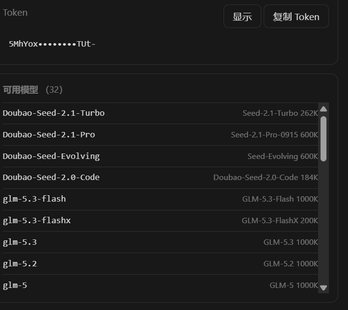

<h1 align="center">trae-cindy-bridge</h1>

<p align="center"><b>Bring the Trae CN quota you're already signed into onto Cindy — zero config, your own quota.</b></p>

<p align="center">
  English · <a href="README.md">简体中文</a>
</p>

<p align="center">
  <a href="#install">Install</a> ·
  <a href="#how-it-works">How it works</a> ·
  <a href="#model-list">Models</a> ·
  <a href="#what-the-panel-shows">Panel</a> ·
  <a href="CHANGELOG.md">Changelog</a> ·
  <a href="https://github.com/linvisxie/trae-cindy-bridge/issues">Issues</a>
</p>

<p align="center">
  <a href="https://github.com/linvisxie/trae-cindy-bridge/releases"></a>
  <a href="LICENSE"></a>
  <a href="https://github.com/linvisxie/trae-cindy-bridge/stargazers"></a>
  <a href="https://github.com/linvisxie/trae-cindy-bridge/issues"></a>
  
  
  
</p>

Bring the **Trae CN** quota you're already signed into onto [Cindy](https://cindy.chat)
and use your own Trae quota right from Cindy's model picker — no API key, no extra
subscription.

The plugin serves a local endpoint at `127.0.0.1:47822` that speaks three protocols
(OpenAI Chat / Anthropic Messages / OpenAI Responses), so all three Cindy harness
engines (`pi` / `claude-code` / `codex`) can connect.

<p align="center">
  
</p>

The **Trae bridge** tab in the right sidebar: account and status light, local port, model
count, quota credits, check-in state. Below that, the Base URL and token (masked by
default, revealed by **Show**), each with its own copy button. Below that, the model list
for the current catalog, each with its context window and price factor.

The panel only reads Trae's own endpoints and your local ledger. It will **never** check
in on your behalf — that click is always yours.

## How it works

```
A chat in Cindy
  -> one of OpenAI Chat / Anthropic Messages / OpenAI Responses
  -> http://127.0.0.1:47822/v1        local endpoint started by this plugin (loopback only)
  -> Cloud-IDE-JWT identity headers + request body shaping   upstream is not OpenAI-compatible
  -> https://trae-api-cn.mchost.guru/api/agent/v3/llm_utils_chat
  -> SSE (errors may hide inside HTTP 200)
  -> peek the head -> translate back into the protocol you asked for
```

Trae is an IDE and is not an OpenAI-compatible endpoint. To make it appear in Cindy's
model picker, three things have to be built:

1. **Read the login state** — Trae stores credentials in its own `storage.json`, wrapped in
   a proprietary AES-128-CBC format that is neither Electron `safeStorage` nor DPAPI.
2. **Translate the protocol** — upstream wants `Cloud-IDE-JWT` identity headers plus a
   private request body (`config_name` selects the model, `function` selects the function
   channel, `tools[].function.parameters` must be serialized to a string), not
   `Authorization: Bearer` plus a standard OpenAI body.
3. **Fish errors out of HTTP 200** — Trae doesn't change the status code on failure; it
   stuffs `event: error` into the SSE body. Left alone, the client treats it as a network
   fault and retries the same doomed request with backoff.

### Upstream requests

Header profiles come in four variants. Common to all: `Authorization: Cloud-IDE-JWT
<token>`, `X-Ide-Token`, `x-plugin-channel: icube-ai`, `x-app-id`, `x-machine-id`,
`x-device-id`, `x-device-type`, `x-app-version-code`, `x-custom-trace-id`,
`x-flow-traceparent`, `request-traffic-type: prod`. The chat profile adds
`X-Cloudide-Token`, `x-uid`, `x-request-id = x-trae-request-id`, and
`Accept: text/event-stream`.

Body shape: `{ messages, model, config_name: model, function: <channel>, stream: true,
tools?, reasoning_effort? }`, with these required conversions: `developer` → `system`;
string content wrapped as `[{type:'text',text}]`; assistant `tool_calls[].function`
renamed to `function_call`; `tools[].function.parameters` **must** be serialized to a
string.

### Tool schema normalization

Two transformations are mandatory:

1. **Drop boolean `required`** — `"required": true` is legal in draft-3 but wrong in
   draft-7 (where `required` must be an array of strings).
2. **Hoist `properties.X.required: true` into the parent `required` array** — draft-3
   allows marking a single property `required: true`; draft-7 only recognizes the parent
   array. Skipping this makes DeepSeek's backend answer `4027`.

### How credentials are read

Path: `%APPDATA%\Trae CN\User\globalStorage\storage.json`, key
`iCubeAuthInfo://icube.cloudide`.

It's a **base64-wrapped proprietary AES-128-CBC format**. Decoded structure:

```
after base64 decode:
  buf[0:6]    type header
              [116, 99, 5, 16, 0, 0]  -> aes
              [18, 57, 32, 32, 2, 3]   -> aes-private
  buf[6:38]   32 random bytes
  buf[38:]    ciphertext (AES-128-CBC, PKCS#7 padding)

derivation:
  derived = sha512( sha512(random) || salt )
  key     = derived[0:16]
  iv      = derived[16:32]

plaintext:
  plaintext[0:64]   sha512 digest of plaintext[64:], for integrity checking
  plaintext[64:]    the actual credential JSON
```

The salts are built-in fixed constants (two tables, one per type header).

**Used in memory only — never written to disk, never sent anywhere.** Credentials are
re-read and re-decrypted on demand (tens of milliseconds) and cached for 5 minutes.

`%APPDATA%` may hold two `storage.json` files at once (`Trae CN` and `TRAE SOLO` are two
different Trae products). The plugin walks every candidate, drops expired ones, and picks
the most recently **logged-in** one by file mtime — that's what 0.1.4 fixed ("took the
first by directory name and kept using a months-old token, so the panel said not signed
in forever").

### Credentials renew themselves

Expired tokens no longer require reopening the client. It uses Trae's own exchange
endpoint `POST /trae/api/v3/oauth/ExchangeToken`:

```
DeviceProof = sign('sha256', "POST\n<path>\n<clientId>\n<refreshToken>\n<timestamp>\n<nonce>", privateKey)
```

- The private key comes from `iCubeAuthInfo://icube-dc:<deviceId>` (an **EC P-256** key
  pair unwrapped by the same AES layer). Node's `crypto.sign('sha256', …)` detects ECDSA
  from the PEM automatically; writing `RSA-SHA256` throws outright.
- The six segments **must** be joined with `\n`. With spaces you get
  `20403 Token device not match` — which looks exactly like a wrong key and sends you
  debugging in the wrong direction.
- ClientID: CN/SG desktop `ono9krqynydwx5` (`IDE_PC`), SOLO `en1oxy7wnw8j9n` (`SOLO_PC`).
- Older clients with no device key pair automatically fall back to the legacy endpoint
  `/cloudide/api/v3/trae/oauth/ExchangeToken` (no DeviceProof).

Two triggers: renew early when **less than 5 minutes** of validity remain, and renew
immediately once when a chat hits `401` / `1001`, then retry the same request (once only —
no retry loop). Concurrent chats share a single renewal (single-flight) so several
requests don't each rotate the refreshToken.

**The new token stays in memory and is never written back to `storage.json`** — the Trae
client writes that file too, and outside edits get clobbered by its next flush.

### Text-to-image

The `trae_draw_image` tool is two and a half steps:

```
POST {chat}/api/ide/v1/tool_text_to_image   body allows only {prompt, image_size?}
  -> flat response {message:"success", uri:"<tos key>"}
POST {chat}/api/ide/v1/get_resource_url     body must be exactly {uri_list:[key]}
  -> {url_map:{"<key>":"<signed URL>"}}
GET  <signed URL>                            bare GET, no Trae headers
```

Gotchas, recorded so they don't get stepped on again:

- The body accepts **only `prompt` and an optional `image_size`**. Adding any of
  `mode_type` / `request_type` / `chat_mode` / `session_id` / `access_type` /
  `image_urls` / `watermark` makes the gateway return a 400 with an empty body.
- `image_size` is validated upstream: `WxH` or the presets
  `2k/3k/4k/square/square_hd/landscape/portrait`, and **total pixels must fall within
  `[3686400, 16777216]`** (512×512 and 1024×1024 are both rejected). Default is
  `1920x1920`, exactly at the lower bound.
- **`GET` on the same path doesn't fetch the image, it makes another one** (billing extra
  credits). Fetching requires exchanging for a signed URL via `get_resource_url` first.
- The model is fixed to `seedream_5` (there's no model field in the body; the server picks).

Images land in `images/trae-<timestamp>-<random>.<ext>` under the data directory.
**Every image really bills your account** — roughly 8.8 credits per 1920×1920 on CN
personal plans; upstream doesn't return the exact number.

### Self-update

The panel's **Check for updates** button / the `trae_update` tool. It reads GitHub
Releases' REST API (public repo, anonymous read — no gh CLI, no proxy config), compares
against the version in `ghost.json`, and on a new release downloads and unpacks it to
`update/stage-<version>`, then hands off to a detached PowerShell script:

```
Wait-Process -Id <current worker pid>        -> wait for self to exit
Copy-Item <install dir> <install dir>.bak-<old version>   (only if the backup doesn't exist)
Copy-Item stage\* <install dir> -Recurse -Force
```

**Why it can't overwrite itself in-process**: a running `.js` file is locked on Windows,
so self-overwrite always fails with `EBUSY`／`EPERM`. About 24 seconds after the worker
exits, Cindy restarts it on the new files.

### Quota and check-in

Base `https://api.trae.cn`, four endpoints:

| Endpoint | Purpose |
|---|---|
| `/trae/api/v2/pay/web_user_ent_usage` | Quota snapshot (total + used + per-source packs) |
| `/trae/api/v2/ug/checkin_credits/status` | Check-in state: claimed today, amount available |
| `/trae/api/v2/ug/checkin_credits/claim` | Claim. Needs `x-device-id`, idempotent per **Beijing date** |
| `/trae/api/v2/ug/activity/info` | Campaign info |

Check-in is the **only** call that changes anything on the account (claiming credits Trae
is already offering your own account), and it never runs automatically.

### Three protocols

All implemented at once:

| Path | Protocol |
|---|---|
| `POST /v1/chat/completions` | OpenAI Chat Completions |
| `POST /v1/responses` | OpenAI Responses |
| `POST /v1/messages` | Anthropic Messages |
| `POST /v1/messages/count_tokens` | Anthropic token counting |

**Why all three are mandatory**: Cindy's `claude-code` engine only accepts
`anthropic-messages`, and `codex` only accepts `openai-responses`. With only
`chat/completions`, the provider would offer just `pi` — cutting most of the bridge's value.

### Components

| File | Role |
|---|---|
| `plugin/main.js` | The brain: forwards AI tool calls and panel requests to the worker |
| `plugin/node/worker.cjs` | Resident Node process: HTTP server, three protocol routes, pinned port, usage ledger |
| `plugin/node/trae.cjs` | Trae upstream client: credential decryption, headers, body shaping, SSE decoding, model catalog, quota and check-in |
| `plugin/node/adapters.cjs` | Protocol translation between Anthropic / Responses and OpenAI Chat |
| `plugin/node/update.cjs` | Pure functions for self-update: version compare, digest check, unzip, script generation |
| `plugin/panel.*` | Right-side panel: account, quota, check-in, model list, Base URL / token |

It **does not modify any Cindy file**, and it won't fill in the provider config for you
(Cindy doesn't expose an interface for that). It gives you an endpoint; the last step is
a few clicks in Cindy's UI.

## Requirements (check each one)

| Dependency | Requirement | Notes |
|---|---|---|
| OS | **Windows 10 / 11** | The one hard limit. The credential path is fixed at `%APPDATA%\Trae CN\...`; other platforms don't have it. |
| Cindy client | **≥ 0.1.119** | That's the `minCindyVersion` in the manifest. Older builds have no `custom_providers` and no node worker. |
| Trae CN client | Installed and **signed in** | It reads the login state the Trae CN desktop app wrote. Never signed in means no credentials. |
| Node.js | **≥ 22** (24 recommended) | Uses `fetch`, `AbortSignal.timeout`, `node:readline`. The worker runs on the Node bundled with Cindy; you only need your own to run the tests. |
| Network | Reachable `trae-api-cn.mchost.guru` / `api.trae.cn` | Assumes a China network environment. |
| Disk | ~100 KB | Plugin itself. Runtime data (logs, usage ledger) is separate, under `%APPDATA%\CindyGlobal\trae-bridge\`. |

> No API key, no OpenAI / Anthropic account, no extra subscription. It uses the quota your
> own Trae account already has.

## Install

### 1. Get the package

Download `trae-cindy-bridge.cindy` from [Releases](../../releases), or build it yourself:

```bat
cd plugin
npm run pack        :: produces dist\trae-cindy-bridge.cindy
```

> The package name must **not** start with `cindy-`. Cindy doesn't accept that prefix, so
> this repo's artifact is `trae-cindy-bridge.cindy`.

A `.cindy` is just a zip (with `ghost.json` at the root). `scripts/pack.cjs` is a
zero-dependency hand-rolled packer — same input, same bytes out.

### 2. Install into Cindy

Cindy → Plugins → import the `.cindy` (or drag the file in).

The first install lists permissions for you to confirm. It declares a **resident Node
process** — which means **it can read and write files on your machine and reach the
network**. That's required to read Trae's login state and serve a local endpoint.
Please make sure you're comfortable with that before installing.

### 3. Add the provider in Cindy (the only manual step)

After installing, a **Trae bridge** tab appears in the right sidebar. It shows
**account / local port / model count / quota credits / check-in**, plus the **Base URL**
and **token**, each with a copy button.

Then: **Cindy Settings → Models → Add custom provider**

| Field | Value |
|---|---|
| Name | Anything, e.g. `Trae` |
| Base URL | `http://127.0.0.1:47822/v1` (whatever the panel shows) |
| API Key | The token from the panel, exactly as shown |
| Model ID | Pick from the panel list and add them one by one |

**Protocol (by engine — pick wrong and that engine stays disabled):**

| Cindy engine | Required protocol |
|---|---|
| `pi` | Any of the three |
| `claude-code` | **Anthropic Messages** (same Base URL, same API key) |
| `codex` | **OpenAI Responses** (keep the trailing `/v1` in the Base URL) |

This is a hard rule in Cindy (`acceptsWireProtocol`: `claude-code` only accepts
`anthropic-messages`, `codex` only accepts `openai-responses`, `pi` accepts all). This
plugin supports all three.

### 4. Afterwards

Just start Cindy normally. The plugin is `resident`, so Cindy pulls the worker up to
`47822` on its own. The token persists in `state.json` and the provider config lives in
Cindy's own database — nothing else to manage.

**Only these three cases need you:**

1. Trae login expired → normally renews itself; if the refreshToken itself expired, sign
   in again in Trae CN and hit **Refresh** in the panel.
2. Port `47822` taken by something else → the worker waits and retries, then falls through
   to `47823`…, and the panel's Base URL changes, so update it in Cindy.
3. Uninstalling and reinstalling the plugin → you'll need to re-enter the provider.

## Model list

The catalog comes from `POST /api/ide/v1/get_detail_param`, which returns 220 rows / 83
ids. Only rows with `usage === 'chat_completion'` are real chat models offered to users;
`summary` / `title_generation` / `input_optimization` / `fast_apply*` are IDE-internal
tools and are all filtered out. On this machine that leaves 32 models.

Visibility uses repin semantics: if a channel doesn't list a model, switch to a visible
channel that does; hide it only when no channel shows it.

### What those `custom_*` entries are

`custom_model` rows are self-built slots. On this machine 12 of them answer `3003` and one
answers `4023` — meaning that account has no such channel. They're kept in the list
(because the row exists) but selecting them fails fast with a `400`, which is the correct
signal: it isn't a network problem and needs no proxy.

### Context window: measured, not copied from the catalog

**Don't trust `context_window_tokens.dev` in the catalog.** Measured upstream usable input
is about 1M (`glm-5.3` only returned `4022` at 1.15M), while the catalog says 200000.
Copying that would hide most of the real capability. `trae.cjs` carries a
`MEASURED_CONTEXT` table filled from measurements (17 models at 1M, Doubao at
600K/262144, unmeasured ones fall back to `dev`).

Correctness was verified: with 1.06M input (`prompt_tokens=942282`), the `ALPHA1060000`
marker buried at the start of the body was read back accurately in 118 seconds — it's not
"fits but unreadable".

### Reasoning efforts

- Upstream uses `light / medium / high / extra_high / max`; we send
  `low / medium / high / xhigh / max`. **`WIRE_EFFORT_MAP` must map between them** —
  sending our names doesn't error upstream, it's silently ignored (that's the real cause of
  "changing the effort level does nothing").
- The real source is the **row-level `reasoning_effort_config`**, not `model_detail_list`
  and not `display_contact_config`. Return an empty array when `support_thinking !== true`;
  don't invent levels.
- Two rules: (1) if upstream explicitly lists options, report only those; (2) models marked
  `model_capability: 'reasoning_model'` or `reasoning.enable === true` get all five levels.

### Fallback order

Channels are tried in order `['solo_work_remote','solo_work_lite','solo_agent_remote',
'chat_v3','solo_coder']`, merged as a union, first response wins. **`solo_agent` cannot
chat at all** (always `4011`) and is excluded.

If the catalog comes back empty, the plugin degrades in three steps: cached `models.json`
→ built-in fallback list → empty list with a clear error. None of this changes "you at
least get a model list", but the 4 fallback entries aren't guaranteed to work on your
account (no guaranteed quota, no guaranteed published channel) — they just keep the UI
from being empty.

## What the panel shows

- **Login state**: green dot / red dot, plus account name and region
- **Local port**: the port actually being listened on
- **Model count**: how many models are in the current catalog
- **Quota / credits**: quota snapshot (total, used, remaining percentage, per-source packs)
- **Check-in**: whether today is claimed, with a **Check in now** button
- **Uptime**: how long the worker has been running
- **Local usage**: how many requests and tokens today (`usage.json`, per day per model,
  kept 60 days)
- **Base URL / token**: one copy button each; the token is masked until you hit **Show**
- **Check for updates**: queries GitHub Releases; if there's a new version the button
  becomes **Install** and a background script replaces the files
- **Log file**: full path to `bridge.log` — look here first when something breaks

The AI side can ask too: six tools — `trae_status`, `trae_endpoint`, `trae_refresh`,
`trae_checkin`, `trae_draw_image`, `trae_update`.

## Error reference

Trae's failure mode is **stuffing the error into an HTTP 200 SSE body** (`event: error` +
`code`) while keeping the status at 200. So the worker peeks at the upstream head first:
if the first few frames are an error, it converts them into a real error status instead of
letting Cindy receive a "successful but empty" stream and guess.

| Upstream code | Worker returns | Meaning and what to do |
|---|---|---|
| `1005` | `402` | This model needs a paid plan. Upgrade in Trae or pick a free model. |
| `2001` | `5xx` (transient) | Upstream hasn't published the function-channel config right now. **Retry in a few minutes; no need to sign in again**, and your account isn't broken. |
| `4001` | `400` | Model isn't in the current function channel. Hit **Refresh** in the panel and pick again. |
| `4008` | `402` | SOLO quota exhausted. Wait for renewal or upgrade. |
| `4011` | `429` | Rate limited. Wait half a minute. |
| `4023` | `400` | The route doesn't recognize this model name. Refresh the list and pick again. |
| `3003` | `400` | `all models failed` — **this account has no channel for that model** (usually `custom_model_*` slots). Returns instantly; not a network problem, **no proxy needed**, just switch models. |
| `4022` | `400` | Input tokens exceeded (`prompt tokens have exceeded the maximum limit`). Trim history or paste less. |
| `4026` | `400` | Context length exceeded (`context length has exceeded the maximum limit`). This model's window is smaller than the 4022 tier — switch to a larger one. |
| `4222` | `402` | Enterprise tenant quota exhausted. Personal balance is unaffected; switch accounts or wait. |
| `4027` | `400` | **Malformed request body**, most often tool schema shape (see "Tool schema normalization"). |

Two more:

- **Login state unreadable / undecryptable** → red dot plus "open Trae CN and sign in
  once, then hit Refresh". Also where a Trae encryption format change lands; the plugin has
  to catch up.
- **Wrong local token** → `401`: "the token from the panel must be entered in Cindy's API
  Key field exactly as shown".

## Preview render note

`trae_draw_image` returns a markdown image whose source is a `file:///` URL built from the
saved path (backslashes normalized, `%`/`#`/`?`/space percent-encoded). The plain Windows
path is also printed on its own line so you can copy it or open the file directly — use
that if your renderer refuses `file://` sources.

## Where runtime data lives

| Path | Contents |
|---|---|
| `%APPDATA%\CindyGlobal\owners\<ownerKey>\cindy-brain\_ns\_root\trae-bridge\` | The plugin itself (install location, managed by Cindy) |
| `%APPDATA%\CindyGlobal\trae-bridge\state.json` | Local endpoint token + port |
| `%APPDATA%\CindyGlobal\trae-bridge\models.json` | Model catalog cache (30 minutes) |
| `%APPDATA%\CindyGlobal\trae-bridge\usage.json` | Local usage ledger (per day per model, kept 60 days, atomic writes) |
| `%APPDATA%\CindyGlobal\trae-bridge\images\` | Images produced by `trae_draw_image` |
| `%APPDATA%\CindyGlobal\trae-bridge\update\` | Self-update packages, staging dirs and replace script |
| `%APPDATA%\CindyGlobal\trae-bridge\bridge.log` | Runtime log with ISO timestamps, rotates to `.1` past 2 MB |

**Your Trae token is never written to any of these files** — it's decrypted fresh from the
Trae client's `storage.json` each time and used only in memory.

Environment variables (rarely needed):

| Variable | Default | Purpose |
|---|---|---|
| `CINDY_TRAE_PORT` | `47822` | Preferred port |
| `CINDY_TRAE_DATA` | `%APPDATA%\CindyGlobal\trae-bridge` | Runtime data directory |

## Development and testing

Each script under `test/` is an independent, re-runnable check. Most **need Trae CN
installed and signed in** (they read real login state and hit the real upstream);
`host-guard`, `responses-status`, `upstream-contract`, `update-chain`, `feature-offline`
are fully local. Without a login, `features` and `e2e-panel` mark login-dependent cases
`--` / `SKIP` instead of crashing — but that means they didn't really verify anything.

When quota is exhausted (upstream returns `4008`), every case that needs an upstream 200
automatically degrades to `SKIP` rather than `FAIL` — that's account state, not a code
regression.

```bat
cd plugin && npm run verify     :: static manifest validation
cd plugin && npm run pack       :: build the package

node test\host-guard.js         :: Host guard, 13 cases (local, no login)
node test\responses-status.js   :: Responses status mapping, 19 cases (local, no login)
node test\upstream-contract.js  :: upstream contract, 16 cases (local: interleaved tool fragments / truncation / usage)
node test\update-chain.js       :: self-update chain, 50 cases (local: version compare / digest / unzip / script generation)
node test\feature-offline.js    :: image params, response parsing, DeviceProof string, image URL, 39 cases (local, no quota)
node test\e2e-package.js        :: package end-to-end, 25 cases (unzip -> start worker -> real chat -> three protocols -> license files)
node test\e2e-panel.js          :: panel script, 17 cases
node test\e2e-brain.js          :: panel <-> brain over a real bus, 13 cases
node test\smoke-protocols.js    :: three protocol shapes, 19 cases
node test\smoke-tools.js        :: tool calls across three protocols, 11 cases
node test\wire-quirks.js        :: Cindy's /v1/v1 and [1m] quirks, 10 cases
node test\features.js           :: effort / context / price factor / quota / error codes / input validation, 51 cases
```

To switch models: `node test\smoke-protocols.js <model id>` (defaults to
`deepseek-v4.1-flash`). Each test opens its own temp directory and port so it won't
collide with a running instance.

**Why the tests look like this**: every one of them guards a specific production incident.
`host-guard` guards against Cindy's proxy stripping the port from the Host header (which
makes the claude-code engine 403). `wire-quirks` guards against a Base URL that already
ends in `/v1` being doubled into `/v1/v1/messages`, and against Cindy encoding the model id
as `deepseek-v4.1-flash[1m]` when 1M context is selected. `e2e-brain` guards against
unwrapping only one of the two layers of `cindy.node.request` (which makes the panel show
"not signed in / 0 models / —"). `responses-status` guards against the top-level and
per-item statuses disagreeing when a Responses stream is truncated or cut by a content
policy. `upstream-contract` guards against interleaved tool fragments being split into
nameless blocks, truncated streams being passed off as complete, and both adapters
swallowing real usage. `feature-offline` pins the measured constraints: the mandatory
`[3686400, 16777216]` pixel range, the six newline-joined DeviceProof segments (spaces get
you `20403`), and the flat image response shape. `update-chain` guards the self-update
path: `0.1.15` sorting newer than `0.1.9`, a package whose sha256 doesn't match the release
digest being rejected before a single byte touches the install directory, and the generated
PowerShell waiting for the old process, backing up, then syncing Cindy's manifest snapshot.

## Local endpoint

| Path | Auth | Notes |
|---|---|---|
| `GET /healthz` | No | Liveness, returns only `{ok, port, modelCount}`. Unauthenticated, so it deliberately exposes nothing else |
| `GET /status` (`/v1/status` alias) | Yes | Full status: account, models, quota, check-in, local usage, log path |
| `GET /v1/models` | Yes | Model catalog (context window, price factor, reasoning efforts) |
| `POST /v1/chat/completions` | Yes | OpenAI Chat protocol |
| `POST /v1/messages`, `POST /v1/messages/count_tokens` | Yes | Anthropic Messages protocol |
| `POST /v1/responses` | Yes | OpenAI Responses protocol |

Auth is `Authorization: Bearer <the token from the panel>`.

### Why the port is pinned

The preferred port is tried first; if it's taken the plugin retries every second, up to 30
times. After 30 seconds, if a probe finds **our own worker** already running (`/healthz`
returning `{ok:true, port, modelCount}`), it exits `0` and yields. Otherwise it falls
through to `PORT+i`.

## Coping with qoder-bridge

**qoder-bridge** and **trae-bridge** can run side by side. They are **two independent
plugins, two independent processes, two independent ports, two independent tokens, two
independent data directories** — they never read or write each other's files, never share
quota, and one failing doesn't affect the other.

| Dimension | qoder-bridge | trae-cindy-bridge |
|---|---|---|
| ghost id | `qoder-bridge` | `trae-bridge` |
| Port | `47821` | `47822` |
| RPC prefix / tool names | `qoder/*`, `qoder_*` | `trae/*`, `trae_*` |
| Panel channel | `qoder-bridge-panel` | `trae-bridge-panel` |
| Data directory | `%APPDATA%\CindyGlobal\qoder-bridge` | `%APPDATA%\CindyGlobal\trae-bridge` |

In Cindy, add them as **two separate custom providers**, each with its own Base URL and key.

**Overlapping model ids don't matter** — the two accounts' model lists overlap heavily
(DeepSeek / GLM / Kimi / Qwen / Minimax), but providers are isolated namespaces and Cindy
won't cross them. That's exactly why it's "two plugins" rather than "one plugin, two
accounts": a single Base URL would require id suffix rewriting, which would break the
"enter the model ID once and keep it" flow, force the stable one to change its id / port /
tool names, and create a single point of failure.

**Don't try to merge them.**

## Known limitations

- **Windows only.** See Requirements above.
- **v1 is CN-region only** (Trae CN) plus the consumer gateway. Enterprise and
  international builds only have config slots; unverified, no compatibility promise.
- **`x-app-version` may not be sent.** The plugin reads
  `%LOCALAPPDATA%\Programs\Trae CN\...\product.json` for the version; if the file is
  missing, that header is omitted. Doesn't affect login or chat — upstream just sees one
  less client detail.
- **Text-to-image is generation only.** Editing an image (sending a reference image
  alongside) requires uploading to TOS through a presigned URL from
  `get_resource_upload_url` — a separate pipeline, not implemented.
- **No account pooling.** One process uses the single current login state; no multi-account
  rotation or quota aggregation.
- **No context tier switching.** The reported window is the measured usable maximum (see
  the table above); Cindy can't trim requests per 128k / 200k / 1M tier — you get whatever
  the window is.
- **Auto-update is not "silent".** Either click **Check for updates** or have the AI call
  `trae_update`. There's no "check at startup, install automatically" — that would mean
  restarting the plugin without your knowledge, and losing power midway could leave half a
  directory behind.
- **The "pricing" line on Cindy's detail page can't be fixed.** The custom-provider model
  parser reads none of `displayPricing` / `currency` / `cost`, so "no pricing data for this
  route" stays; the price factor can only live in the model name and the panel.
- **Depends on Trae's internal endpoints.** When upstream changes, the plugin breaks. This
  is not a "long-term stable" thing.
- **A credential format change breaks it.** The proprietary AES wrapper is
  reverse-engineered; when Trae changes encryption (or rotates the salt), the plugin must be
  updated before it works again.

## Disclaimer

For personal study and research only, driving **your own** Trae account from your own
machine. You are responsible for complying with Trae's terms of service; the author accepts
no liability for consequences of use. This project is not affiliated with, authorized by,
or endorsed by Trae (ByteDance) or Cindy.

Every request the plugin makes except **daily check-in** is **read-only**. Check-in is the
only operation that changes anything on your Trae account (claiming credits Trae is already
offering **to your own account**), it never runs automatically, and it always requires a
manual click. Whether you use it — and whether it complies with Trae's current terms — is
your call.

To be explicit about the risks:

1. **This is a reverse-engineered implementation, not an official API.** Requests
   impersonate the Trae IDE client identity against Trae's own gateway. Trae's terms most
   likely don't permit this kind of use.
2. **Use at your own risk.** It could get your account rate-limited, have your quota zeroed,
   or get you banned. The author accepts no responsibility and offers no warranty.
3. **Don't use it to violate upstream terms**, and don't use it to circumvent billing or
   quota limits — it circumvents nothing. It spends your own account's quota.
4. **Login state stays in local memory.** The plugin does not collect or upload your token,
   chat content, or any account information.
5. Runtime logs, a usage ledger and generated images stay under
   `%APPDATA%\CindyGlobal\trae-bridge\` — **read them before sharing**.

## License

Released under **MIT**. See [LICENSE](LICENSE).

The protocol layer (credential decryption, request headers, SSE decoding, message
conversion, channel resolution) references
[`dsh-connect-trae`](https://github.com/dingminhua/dsh-connect-trae) by dingminhua (MIT,
Copyright 2026 LaoDing) and
[`dsh-trae-api`](https://github.com/Wang-JQ77/dsh-trae-api) by Wang-JQ77 (MIT). Their
copyright notices and full license texts are in
[THIRD-PARTY-NOTICES.md](THIRD-PARTY-NOTICES.md) and **must be kept with this project**.

"Trae", "Cindy" and other names and trademarks belong to their respective owners and are
used here for reference only.
