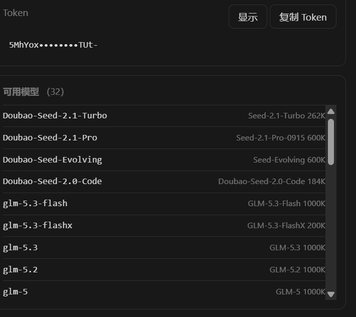
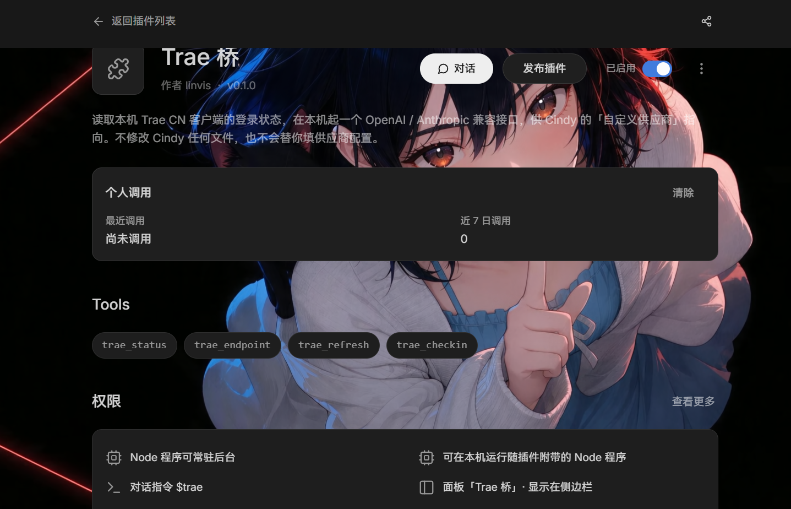

<h1 align="center">trae-cindy-bridge</h1>

<p align="center"><b>把本机已登录的 Trae CN 额度接入 Cindy，零配置用你自己的账号额度。</b></p>

<p align="center">
  <a href="#安装">安装</a> ·
  <a href="#工作原理">工作原理</a> ·
  <a href="#模型列表">模型</a> ·
  <a href="#面板能看什么">面板</a> ·
  <a href="CHANGELOG.md">更新日志</a> ·
  <a href="https://github.com/linvisxie/trae-cindy-bridge/issues">问题反馈</a>
</p>

<p align="center">
  <a href="https://github.com/linvisxie/trae-cindy-bridge/releases"></a>
  <a href="LICENSE"></a>
  <a href="https://github.com/linvisxie/trae-cindy-bridge/stargazers"></a>
  <a href="https://github.com/linvisxie/trae-cindy-bridge/issues"></a>
  
  
  
</p>

把本机已登录的 **Trae CN** 额度接入 [Cindy](https://cindy.chat)，
在 Cindy 的模型选择器里直接用你自己的 Trae 账号额度 —— 不需要 API Key，不需要额外订阅。

插件在 `127.0.0.1:47822` 起一个本地端点，同时讲三种协议（OpenAI Chat / Anthropic Messages / OpenAI Responses），
Cindy 的三个 harness 引擎（`pi` / `claude-code` / `codex`）都能接。

<p align="center">
  
</p>

右侧栏的「Trae 桥」面板：账号与绿灯、本地端口、模型数、额度积分、签到状态，
下面是 Base URL 与 Token（默认打码，点「显示」才露出来），两个各有一个复制按钮，
再下面是当前目录里的模型清单，每个带上下文窗口与倍率。

面板只读 Trae 自己的接口和你本机的账本，**不会**替你自动签到，签到那一下永远要你自己点。

## 工作原理

```
Cindy 里的对话
  -> OpenAI Chat / Anthropic Messages / OpenAI Responses 三种协议之一
  -> http://127.0.0.1:47822/v1        本插件起的本地端点（只听 127.0.0.1）
  -> Cloud-IDE-JWT 身份头 + 请求体整形   上游不是 OpenAI 兼容端点
  -> https://trae-api-cn.mchost.guru/api/agent/v3/llm_utils_chat
  -> SSE（错误可能藏在 HTTP 200 里）
  -> peek 头部 -> 翻回对应协议
```

Trae 是个 IDE，本身不是 OpenAI 兼容端点。想让它出现在 Cindy 的模型选择器里，需要有人把三件事做完：

1. **读登录态** —— Trae 把凭据存在自己的 `storage.json` 里，是自研的 AES-128-CBC 封装，不是 Electron `safeStorage`，也不是 DPAPI。
2. **翻译协议** —— 上游用 `Cloud-IDE-JWT` 身份头 + 私有请求体（`config_name` 指定模型、`function` 指定函数通道、`tools[].function.parameters` 要序列化成字符串），不是 `Authorization: Bearer` + 标准 OpenAI 体。
3. **把 HTTP 200 里的错误捞出来** —— Trae 失败时不改状态码，直接往 SSE body 里塞 `event: error`。不处理的话，客户端会把它当网络故障按退避策略反复重试同一个必死请求。

这三件事本来就该有个进程在本机干，不该每个客户端各做一遍。所以做成插件。

### 上游请求

```
POST https://trae-api-cn.mchost.guru/api/agent/v3/llm_utils_chat
Authorization: Cloud-IDE-JWT <token>
X-Ide-Token: <token>
X-Cloudide-Token: <token>
x-uid: <uid>
x-plugin-channel: icube-ai
x-app-id: <app id>
x-machine-id / x-device-id / x-device-type: <本机标识>
x-app-version: <Trae 版本>   // 读不到 product.json 时这个头不发
```

请求体：

```json
{
  "messages": [...],
  "model": "<模型 id>",
  "config_name": "<模型 id>",
  "function": "<函数通道名>",
  "stream": true,
  "tools": [...],
  "reasoning_effort": "high"
}
```

`tools` / `reasoning_effort` 是可选字段，不传就不发。

### 工具 schema 归一化

上游要求 `tools[].function.parameters` 是**字符串**而不是 object，所以序列化这一步必须做。

光序列化还不够：工具 schema 如果是 draft-3 风格（很多 MCP 工具和老 SDK 生成的都长这样），DeepSeek 后端会**整条请求拒掉**并回 `4027`，而错误信息里不会告诉你是哪个字段。所以还要做两步归一化：

1. **去掉 boolean 型 `required`** —— `"required": true` 在 draft-3 里合法，在 draft-7 里是错的（`required` 必须是字符串数组）。
2. **把 `properties.X.required: true` 提成父级 `required` 数组** —— draft-3 允许在单个属性上标 `required: true`，draft-7 只认父级数组。

### 凭据怎么读

路径：`%APPDATA%\Trae CN\User\globalStorage\storage.json`，取键 `iCubeAuthInfo://icube.cloudide`。

它是 **base64 包装的自有 AES-128-CBC 格式**。解开的结构：

```
base64 解码后：
  buf[0:6]    类型头
              [116, 99, 5, 16, 0, 0]  -> aes
              [18, 57, 32, 32, 2, 3]   -> aes-private
  buf[6:38]   32 字节随机数
  buf[38:]    密文（AES-128-CBC，PKCS#7 padding）

派生：
  derived = sha512( sha512(random) || salt )
  key     = derived[0:16]
  iv      = derived[16:32]

明文：
  plaintext[0:64]   sha512(plaintext[64:]) 的摘要，用于完整性校验
  plaintext[64:]    真正的凭据 JSON
```

salt 用内置的固定常量表（两张，对应两个类型头）。

**只在内存里用，不写盘、不外发。** 每次要凭据时现读现解（几十毫秒），缓存 5 分钟。

本机 `%APPDATA%` 下可能同时存在 `Trae CN` 与 `TRAE SOLO` 两份 storage.json（两个不同的 Trae 产品）。插件会遍历全部候选，剔掉已过期的，再按文件 **mtime 从新到旧**取最后登录的那一份 —— 0.1.4 修的就是「按目录名取第一份，结果一直用着几十天前的旧 token，面板永远未登录」。

### 凭据会自己续期

token 到期不用再重开客户端。走 Trae 自己的换票接口 `POST /trae/api/v3/oauth/ExchangeToken`：

```
DeviceProof = sign('sha256', "POST\n<path>\n<clientId>\n<refreshToken>\n<timestamp>\n<nonce>", 私钥)
```

- 私钥来自 `iCubeAuthInfo://icube-dc:<deviceId>`（同一套 AES 封装解出来的 **EC P-256** 密钥对）。节点 `crypto.sign('sha256', …)` 会按 PEM 自动判 ECDSA，写成 `RSA-SHA256` 会直接抛。
- 六段必须用 `\n` 连接，用空格会回 `20403 Token device not match`。
- ClientID：CN/SG 桌面版 `ono9krqynydwx5`（`IDE_PC`），SOLO 版 `en1oxy7wnw8j9n`（`SOLO_PC`）。
- 没带设备密钥对的老客户端自动退回 legacy 接口 `/cloudide/api/v3/trae/oauth/ExchangeToken`（无 DeviceProof）。

触发时机两个：凭据 **剩余有效期 < 5 分钟** 时提前换；对话撞上 `401` / `1001` 时当场换一次、再重试同一个请求（只试一次，不会死循环）。并发对话共用一次换票（单飞去重），免得几条请求各换各的把 refreshToken 轮转掉。

**换到的票只放内存，不写回 `storage.json`** —— Trae 客户端自己也在写那个文件，从外面改会被它下一次 flush 覆盖。

### 文生图

新工具 `trae_draw_image`，两步半：

```
POST {chat}/api/ide/v1/tool_text_to_image   body 只允许 {prompt, image_size?}
  → 扁平响应 {message:"success", uri:"<tos key>"}
POST {chat}/api/ide/v1/get_resource_url     body 必须正是 {uri_list:[key]}
  → {url_map:{"<key>":"<签名 URL>"}}
GET  <签名 URL>                              裸 GET，不带任何 Trae 头
```

几个坑写在这里省得再踩：

- 请求体**只认 `prompt` 和可选的 `image_size`**。多带 `mode_type` / `request_type` / `chat_mode` / `session_id` / `access_type` / `image_urls` / `watermark` 里任何一个，网关直接 400 空 body。
- `image_size` 校验在上游：`宽x高` 或预设 `2k/3k/4k/square/square_hd/landscape/portrait`，**总像素必须落在 `[3686400, 16777216]`**（512×512、1024×1024 都会被拒）。默认 `1920x1920`，正好卡下限。
- **`GET` 同一个路径不是取图，是又生成一张**（多扣一次积分）。取图必须先 `get_resource_url` 换签名地址。
- 模型固定 `seedream_5`（请求体里没有 model 字段，服务端自选）。

图片落到数据目录 `images/trae-<时间戳>-<随机>.<ext>`。**每张真实扣账号积分**，CN 个人版 1920×1920 一张约 8.8，上游不回传具体数字。

### 自查更新

面板「检查更新」按钮 / 工具 `trae_update`。读 GitHub Releases 的 REST 接口（公开仓库匿名可读，不依赖 gh CLI、不需要代理配置），比对 `ghost.json` 里的版本号，有新包就下载解到 `update/stage-<版本>`，然后交给一个 detached PowerShell 脚本：

```
Wait-Process -Id <当前 worker pid>   → 等自己退出
Copy-Item <安装目录> <安装目录>.bak-<旧版本>  （仅在备份不存在时）
Copy-Item stage\* <安装目录> -Recurse -Force
```

**为什么不能在本进程里直接覆盖**：Windows 上正在运行的 `.js` 被锁，自己覆盖自己一定 `EBUSY`／`EPERM`。Cindy 检测到 worker 退出后约 24 秒用新文件重新拉起。

### 额度与签到

基址 `https://api.trae.cn`，四个端点：

| 端点 | 作用 |
|---|---|
| `/trae/api/v2/pay/web_user_ent_usage` | 额度快照（总额度 + 已用 + 各来源包） |
| `/trae/api/v2/ug/checkin_credits/status` | 签到状态：今天签没签、能领多少 |
| `/trae/api/v2/ug/checkin_credits/claim` | 领。需要 `x-device-id`，按**北京日期**幂等 |
| `/trae/api/v2/ug/activity/info` | 活动信息 |

签到是**唯一**会对账号产生变更的调用（领取 Trae 正在向你自己的账号发放的积分），不会自动执行。

### 三种协议

同时实现：

| 路径 | 协议 |
|---|---|
| `POST /v1/chat/completions` | OpenAI Chat Completions |
| `POST /v1/responses` | OpenAI Responses |
| `POST /v1/messages` | Anthropic Messages |
| `POST /v1/messages/count_tokens` | Anthropic token 计数 |

**为什么非要三种都有**：Cindy 的 `claude-code` 引擎只接 `anthropic-messages`，`codex` 引擎只接 `openai-responses`。只给 `chat/completions` 的话，供应商里就只剩 `pi` 一个引擎能选 —— 那等于把这个桥的价值砍掉大半。

### 四个组件

| 文件 | 角色 |
|---|---|
| `plugin/main.js` | 电子脑：把 AI 的工具调用与面板请求转给 worker |
| `plugin/node/worker.cjs` | Node 常驻进程：起 HTTP 服务、三条协议路由、端口咬死、用量账本 |
| `plugin/node/trae.cjs` | Trae 上游客户端：解密登录态、请求头、请求体整形、SSE 解码、模型目录、额度签到 |
| `plugin/node/adapters.cjs` | Anthropic / Responses 与 OpenAI Chat 之间的协议翻译 |
| `plugin/panel.*` | 右侧栏面板：账号、额度、签到、模型列表、Base URL / Token |

它**不改 Cindy 的任何文件**，也不替你填供应商配置（Cindy 没给插件这个接口）。它就是给你一个端点，剩下那步在 Cindy 界面里点。

## 环境依赖（请逐条核对）

| 依赖 | 要求 | 说明 |
|---|---|---|
| 操作系统 | **Windows 10 / 11** | 唯一硬限制。凭据路径固定在 `%APPDATA%\Trae CN\...`，其他平台没有这个目录。 |
| Cindy 客户端 | **≥ 0.1.119** | 清单里写的就是这个 `minCindyVersion`。更老的版本没有 `custom_providers` 自定义供应商，也没有 node worker。 |
| Trae CN 客户端 | 已安装并**已登录** | 走的是 Trae CN 桌面应用写下的登录态。没登录过就读不到凭据。 |
| Node.js | **≥ 22**（推荐 24） | 用的是 `fetch`、`AbortSignal.timeout`、`node:readline` 等；worker 跑在 Cindy 自带的那份 Node 里，只有你要跑测试时才需要自己装。 |
| 网络 | 能访问 `trae-api-cn.mchost.guru` / `api.trae.cn` | 走 CN 网络环境。 |
| 磁盘 | ~100 KB | 插件本体；运行数据（日志、用量账本）另算，在 `%APPDATA%\CindyGlobal\trae-bridge\`。 |

> 不需要 API Key，不需要 OpenAI / Anthropic 账号，不需要额外订阅。用的是你自己 Trae 账号里已有的那份额度。

## 安装

### 1. 拿包

从 [Releases](../../releases) 下载 `trae-cindy-bridge.cindy`，或者自己打一个：

```bat
cd plugin
npm run pack        :: 产出 dist\trae-cindy-bridge.cindy
```

`.cindy` 就是个 zip（`ghost.json` 在根部），`scripts/pack.cjs` 是零依赖的手写打包器，同样输入产出同样字节。

> 文件名必须以 **`trae-cindy-bridge`** 开头。Cindy 不认 `cindy-` 打头的包名。

### 2. 装进 Cindy

Cindy → 插件页 → 导入 `.cindy`（也可以直接把文件拖进去）。

首次安装会列权限让你确认。它声明了 **Node 常驻进程** —— 这个能力意味着**能读写你本机文件、能联网**，是读 Trae 登录态和起本地服务所必需的。装之前请确认你接受这一点。

<p align="center">
  
</p>

四个 Tools（`trae_status` / `trae_endpoint` / `trae_refresh` / `trae_checkin`）是 AI 侧可以直接问的东西，不用开面板。

### 3. 在 Cindy 里加供应商（唯一需要手动做的一步）

装完插件后，右侧栏会出现「Trae 桥」页签。面板上能看到 **登录态 / 账号 / 本地端口 / 模型数 / 额度积分 / 签到 / Base URL / Token**，Base URL 和 Token 各有一个复制按钮。

然后：**Cindy 设置 → 模型 → 添加自定义供应商 → OpenAI 兼容**

| 字段 | 填什么 |
|---|---|
| 名称 | 随便，比如 `Trae` |
| Base URL | `http://127.0.0.1:47822/v1`（以面板显示为准） |
| API Key | 面板上那串 Token，一字不差 |
| 模型 ID | 从面板列表里挑，逐个添加 |

**协议（按引擎选，选错那个引擎就不亮）：**

| Cindy 引擎 | 必须选的协议 |
|---|---|
| `pi` | 任意一个都行 |
| `claude-code` | **Anthropic Messages** |
| `codex` | **OpenAI Responses** |

这是 Cindy 的硬规则（`acceptsWireProtocol`：`claude-code` 只接 `anthropic-messages`、`codex` 只接 `openai-responses`、`pi` 全接）。三条本插件都支持。

### 4. 之后

正常启动 Cindy 就行。插件是 `resident`，Cindy 起来自己把 worker 拉到 `47822`；token 持久化在 `state.json`，供应商配置存在 Cindy 自己的数据库里，都不用再管。

**只有这三种情况需要你动手：**

1. Trae 登录过期 → 在 Trae CN 客户端重新登录，然后点面板上的「刷新」。
2. 卸载重装插件 → 供应商要重新填一次。
3. `47822` 被**别的软件**占了 → 才需要改端口（见下面「端口为什么咬死」）。

## 模型列表

模型目录不是简单的「问一个 models 接口」，而是**按函数通道逐个问**：

```
POST https://trae-api-cn.mchost.guru/api/ide/v1/get_detail_param
通道顺序：solo_work_remote → solo_work_lite → solo_agent_remote → chat_v3 → solo_coder
```

每个通道回自己支持的模型，每行都带 `usage` 与 `is_invisible_to_user` 两个关键位。合并规则照上游语义：

1. 只留 `usage === 'chat_completion'` 的行 —— 那才是真正给用户选的聊天模型；
2. 同一模型在多个通道各有一行，**优取排在前面的那个可见行**；
3. 当前行不可见、但别的通道有可见行 → **换到那个通道**（不删模型）；
4. 所有行都不可见 → **不列**。

本机 83 个 id 最后落到 32 个可见可聊的模型。

### 那些 `custom_*` 到底是什么

上游 83 个 id 里只有 38 个是 `usage='chat_completion'`，其余是这些：

| `usage` | 数量 | 是什么 | 本机实测 |
|---|---|---|---|
| `custom_model` | 20 | **用户自建模型槽**（你自己在 Trae 里挂的第三方 key） | 12 个回 `3003 all models failed`、`custom_model_gemini` 回 `4023`，只有 `custom_model_gpt-5` / `custom_model_gpt-6` 真能聊 |
| `summary` / `title_generation` / `input_optimization` / `fast_apply` / `fast_apply_new` | 5 | **IDE 内部工具模型**（生成标题、压缩上下文、快速改写） | 能调通，但输出不是给对话用的 |

这些从 0.1.2 起全部不进模型列表：上游自己的注释原话是「none of those belong in a model picker」，把它们列出来只会让人点到一堆秒回错误号的死模型。

> 如果你之前看到一个叫 `claude` 的模型一直「网络重连」——那就是 `custom_model_claude`，它回的是 `3003 all models failed`（120ms 秒回，不是超时）。**这是账号没开这个自建槽的通道，跟网络、代理、VPN 都没关系。** 现在它已经不在列表里了；如果以后又出现，换成 `glm-5.3` / `deepseek-v4.1-flash` 就行。

倍率同理，只在 `display_contact_config` 的 `consumption_rate.enable === true` 时才取 `.data.rate`；上游没给就**保持裸名，不编造**。

### 上下文窗口：按实测填，不照抄目录

每行有好几个容易搞混的字段：

| 字段 | 本机实测值 | 含义 |
|---|---|---|
| `context_window_tokens.dev` | 200000 | 上游给客户端的**建议值**，不是硬上限 |
| `context_window_tokens.max` | 200000 | 只在 `display_config.max_mode === true` 时才有效 |
| `model_detail_list[0].prompt_max_tokens` | 168000 | 上游的「保守可用输入」，比窗口小一截 |
| `model_detail_list[0].max_tokens` | 32000 | 单次**输出**上限 |

0.1.1 之前误把 `prompt_max_tokens` 当窗口，所以 glm-5.3 / deepseek-v4.1-flash 这一大批全显示 168K；0.1.1 改取 `dev`，显示 200K。**但 200K 也是保守值** —— 真打上游按 `4022` / `4026` 边界扫下来，这些模型的可用输入是 ~1M。

所以 0.1.2 起用一张**实测表**（`trae.cjs` 的 `MEASURED_CONTEXT`）覆盖目录值：

| 实测可用输入 | 模型 |
|---|---|
| 1000000 | glm-5.3 / -flash / -flashx、glm-5.2、glm-5.1、glm-5、deepseek-v4.1-flash、DeepSeek-V4-Pro(-Official)、DeepSeek-V4-Flash、kimi-k3、kimi-k2.6、minimax-m3、qwen3.8-max、qwen-3.5、step-5-preview、mimo-v2.6-flash / -pro |
| 600000 | Doubao-Seed-2.1-Pro、Doubao-Seed-Evolving |
| 262144 | Doubao-Seed-2.1-Turbo |
| 目录 `dev` | 其余未实测的模型（保守回落，不吹） |

验证方式不是「塞进去不报错」就算：给 `deepseek-v4.1-flash` 灌 1.06M 输入（实际 `prompt_tokens=942282`），正文开头埋的记号 `ALPHA1060000` **被准确读出来了**，耗时 118 秒。真 1M，不是塞得进读不到。

Doubao 系列确实小：`2.1-Turbo` 400K 就 `4026`，Code 系 600K 也 `4026`，所以按各自实测值填，不一刀切。

### 推理档位

三条判据，按顺序来：

1. 行级 `reasoning_effort_config` 里 `support_thinking === true` 且给了 `options` → **只报它明说的那几个**（本机只有 `minimax-m3.1-flash` 的 `low/high/xhigh`、`Doubao-Seed-Code` 的 `low/high`）；
2. 没说 options，但 `display_config.model_capability === 'reasoning_model'` 或 `reasoning.enable === true` → **报全套五档** `low/medium/high/xhigh/max`；
3. 纯 chat 模型（`chat_model` 且 `reasoning.enable !== true`）→ 不报档位。

上游线上的档位名与我们不同，发之前必须映射：

```
low → light    medium → medium    high → high    xhigh → extra_high    max → max
```

把 `low` / `xhigh` 原样发过去**不会报错，会被静默忽略** —— 表现就是「档位调了没反应」，这是这段代码最容易踩的坑。

第 2 条判据不是拍脑袋：实测对 6 个模型分别发 `light/medium/high/extra_high/max`，全程 HTTP 200，从没出现 `4001` / `4027`；`deepseek-v4.1-flash` 的思考长度随 low→high→xhigh 单调上升（completion 23→24→27），`glm-5.3-flash` 六档的 reasoning_tokens 也从 35 涨到 126~133（抖动大但档位确实在起作用）。参考实现只认 `options`、其余一律丢弃，所以它那边只有 2 个模型能调档位。

按这套判据本机 **32 个模型带档位**。**不能保证「所有模型都有档位」**：剩下那些是纯 chat 模型，上游压根不做思考，硬塞五档只会让人以为能调。

档位名**不能拼进模型显示名**。Cindy 的模型选择器是按名字宽度撑开的，名字一长整排控件就被推离麦克风（0.1.3 修的就是这个）。档位本来就走 `/v1/models` 的 `reasoning.supported_efforts` 交给 Cindy 渲染成独立下拉 —— 必须挂在 `reasoning` 下，因为 Cindy 的解析器只保留白名单字段，顶层 `reasoning_efforts` 会被丢掉。

### 降级顺序

1. 某个通道临时缺口 → 该通道跳过，其余照常；
2. 所有通道都没拿到（网络抖动 / 登录态临时失效）→ 退回磁盘缓存 `models.json`；
3. 缓存也没有 → 用内置 4 条兜底：

```
DeepSeek-V4-Flash-Official
DeepSeek-V4-Pro-Official
glm-5.2
kimi-k2.6
```

这三个降级都不改变「至少有个能用的模型列表」，但兜底那 4 条不保证在你的账号上真的可用（不保证有额度、不保证通道已发布），只是让界面不至于空着。

## 面板能看什么

- **登录态**：绿灯 / 红点，以及账号名与区域
- **本地端口**：当前实际监听的端口
- **模型数**：当前目录里有多少个模型
- **额度 / 积分**：额度快照（总额度、已用、剩余百分比、各来源包）
- **签到**：今天签没签，带「立即签到」按钮
- **运行时长**：worker 活了多久
- **本地用量**：今天本地打了多少请求、多少 token（`usage.json`，按天按模型记账，留 60 天）
- **Base URL / Token**：各一个复制按钮，Token 默认打码，点「显示」才露出来
- **检查更新**：查 GitHub Releases 有没有新版；有的话按钮变成「安装」，点一下由后台脚本替换
- **日志文件**：`bridge.log` 的完整路径，出问题先看它

AI 侧也能问：`trae_status`、`trae_endpoint`、`trae_refresh`、`trae_checkin`、`trae_draw_image`、`trae_update` 六个工具。

## 报错对照表

Trae 的失败方式是**把错误塞进 HTTP 200 的 SSE body 里**（`event: error` + `code`），状态码照旧是 200。所以 worker 会先 peek 上游头部若干帧：如果头几帧就是错的，直接把它翻成真正的错误状态码返回，而不是让 Cindy 收到一个「成功但空内容」的流然后自己猜。

真错误码：

| 上游 code | worker 返回 | 含义与怎么处理 |
|---|---|---|
| `1005` | `402` | 这个模型需要付费套餐。去 Trae 里升级，或者换一个免费模型。 |
| `2001` | `5xx`（临时性） | 上游这会儿没发布该函数通道的配置。**过几分钟重试就行，不用重新登录**，也别以为是自己的号坏了。 |
| `4001` | `400` | 模型不在当前函数通道里。在面板点「刷新」重拉模型列表，再重新选一次模型。 |
| `4008` | `402` | SOLO 额度耗尽。等额度刷新或升级套餐。 |
| `4011` | `429` | 限流。等半分钟再发。 |
| `4023` | `400` | 路由不认这个模型名。刷新模型列表后重选。 |
| `3003` | `400` | `all models failed` —— **这个账号没有该模型的通道**（多为 `custom_model_*` 自建槽）。秒回，不是网络问题，**不用挂代理**，换模型即可。 |
| `4022` | `400` | 输入 token 超上限（`prompt tokens have exceeded the maximum limit`）。清历史或少贴长文件。 |
| `4026` | `400` | 上下文长度超上限（`context length has exceeded the maximum limit`）。这个模型的窗口比 4022 那档更小，换窗口大的模型。 |
| `4222` | `402` | 企业租户额度耗尽。个人余额不受影响，换个人账号或等刷新。 |
| `4027` | `400` | **请求体不合规**，最常见是工具 schema 的形状问题（见上面「工具 schema 归一化」）。 |

另外两类：

- **登录态读不到 / 解不开** → 面板红点 + 提示「先打开 Trae CN 登录一次，然后点刷新」。Trae 改过加密格式时也会走到这里，此时只能等插件跟进。
- **本地 Token 不对** → `401`，提示「面板上那串 Token 要一字不差地填进 Cindy 的 API Key 栏」。

## 运行数据在哪

| 路径 | 内容 |
|---|---|
| `%APPDATA%\CindyGlobal\owners\<ownerKey>\cindy-brain\_ns\_root\trae-bridge\` | 插件本体（装的位置，随 Cindy 管理） |
| `%APPDATA%\CindyGlobal\trae-bridge\state.json` | 本地端点 token + 端口 |
| `%APPDATA%\CindyGlobal\trae-bridge\models.json` | 模型目录缓存（30 分钟） |
| `%APPDATA%\CindyGlobal\trae-bridge\usage.json` | 本地用量账本（按天按模型，留 60 天，原子写） |
| `%APPDATA%\CindyGlobal\trae-bridge\images\` | `trae_draw_image` 生成的图片 |
| `%APPDATA%\CindyGlobal\trae-bridge\update\` | 自查更新的下载包、暂存目录与替换脚本 |
| `%APPDATA%\CindyGlobal\trae-bridge\bridge.log` | 运行日志，带 ISO 时间戳，超 2 MB 自动滚成 `.1` |

**你的 Trae token 不会被写进这些文件** —— 每次都是现从 Trae 客户端目录里的 `storage.json` 解密，只在内存里用。

环境变量（一般不用改）：

| 变量 | 默认 | 作用 |
|---|---|---|
| `CINDY_TRAE_PORT` | `47822` | 首选端口 |
| `CINDY_TRAE_DATA` | `%APPDATA%\CindyGlobal\trae-bridge` | 运行数据目录 |

## 开发与测试

`test/` 下每个脚本都是独立的、可复跑的判据。多数脚本**需要先装好并登录 Trae CN**（要真读登录态、真打上游）；`host-guard`、`responses-status`、`upstream-contract` 是纯本地的。没登录时 `features` 与 `e2e-panel` 会把依赖登录态的用例打 `--` / `SKIP` 跳过，不会崩，但那样等于没验到。

额度耗尽（上游回 `4008`）时，所有需要上游 200 的用例会自动降级成 `SKIP` 而不是 `FAIL` —— 那是账号状态，不是代码回归。

```bat
cd plugin && npm run verify     :: 清单静态校验
cd plugin && npm run pack       :: 打包

node test\host-guard.js         :: Host 守卫 13 项（纯本地，不需要登录）
node test\responses-status.js   :: Responses 状态映射 19 项（纯本地，不需要登录）
node test\upstream-contract.js  :: 上游契约 16 项（纯本地：交错工具分片 / 截断判定 / usage 回传）
node test\e2e-package.js        :: 包端到端 24 项（解包 → 起 worker → 真对话 → 三条协议 → 许可文件）
node test\e2e-panel.js          :: 面板脚本 17 项
node test\e2e-brain.js          :: 面板 ↔ 电子脑真实总线 13 项
node test\smoke-protocols.js    :: 三条协议形状 19 项
node test\smoke-tools.js        :: 三条协议的 tool call 11 项
node test\wire-quirks.js        :: Cindy 的 /v1/v1 与 [1m] 怪癖 10 项
node test\features.js           :: 档位 / 上下文 / 倍率 / 额度 / 错误码 / 输入校验 51 项
```

想换模型：`node test\smoke-protocols.js <模型 id>`（默认 `deepseek-v4.1-flash`）。
每个测试自己开临时目录与独立端口，不会踩到正在跑的实例。

**为什么这些测试长这样**：它们都在防具体的线上事故 —— `host-guard` 防 Cindy 的代理转发时把 Host 头改成不带端口（那会让 claude-code 引擎 403）；`wire-quirks` 防 Base URL 带 `/v1` 被叠成 `/v1/v1/messages`、以及上下文选 1M 时 Cindy 把模型 id 编成 `deepseek-v4.1-flash[1m]`；`e2e-brain` 防 `cindy.node.request` 的双层信封只剥一层（那会让面板显示「未登录 / 0 个 / —」）；`responses-status` 防 Responses 被截断或内容策略掐断时顶层与子项状态各说各话，也钉死「子项 status 只能是 `in_progress` / `completed` / `incomplete`」——`failed` 只属于顶层 `Response`；`upstream-contract` 防的是交错工具分片被拆成空名字的块、上游断流时半截回答被当完整、以及两路适配器吞掉真实 usage；`features` 里那几条窗口与档位断言，防的是「把 `prompt_max_tokens` 当窗口」「给纯 chat 模型编造倍率与档位」。

## 本地端点

| 路径 | 鉴权 | 说明 |
|---|---|---|
| `GET /healthz` | 否 | 探活，**只回 `{ok, port, modelCount}`**。不鉴权，所以只给这三个字段 —— 本地 Token 不放这儿 |
| `GET /status`（`/v1/status` 同义） | 是 | 完整状态：账号、区域、模型、额度、签到、本地用量、日志路径 |
| `GET /v1/models` | 是 | 模型目录（含上下文窗口、倍率、推理档位） |
| `POST /v1/chat/completions` | 是 | OpenAI Chat 协议 |
| `POST /v1/messages`、`POST /v1/messages/count_tokens` | 是 | Anthropic Messages 协议 |
| `POST /v1/responses` | 是 | OpenAI Responses 协议 |

鉴权就是 `Authorization: Bearer <面板上那串 Token>`。

### 端口为什么咬死

优先 `47822`。被占了就**等最多 30 秒**（多半是上一个 worker 还没退干净，等它退）；30 秒后还占着，先探测一下对方：如果是另一个健康的 Trae 桥（`/healthz` 回 `ok:true` 且带 `port` 与 `modelCount`），就**让位退出**，不抢。

不轻易顺延端口，也不把端口漂移当正常行为 —— 因为 Base URL 是**手填一次、长期使用**的。端口一漂，Cindy 里那条供应商配置就失效，界面只会显示「重新连接中」，用户根本不知道发生了什么。

## 隐私与安全

1. **只在本机回环上监听**。`127.0.0.1:47822`，局域网和公网都碰不到。
2. **凭据不落盘**。`storage.json` 是现读现解，解密结果只活在 worker 进程内存里，进程退了就没了。
3. **`/healthz` 不鉴权但不泄露**。只回 `{ok, port, modelCount}`，任何能连上 loopback 的进程拿到这三个字段也没用。
4. **网络出口只有两个域名**：`trae-api-cn.mchost.guru`（对话与模型目录）、`api.trae.cn`（额度与签到）。
5. **不收集、不上传**聊天内容、token 或账号信息。没有遥测。
6. **日志里会留运行痕迹**。`bridge.log` 会记请求路径、模型名、错误码与耗时，不记消息正文。分享日志前先自己看一眼。

## 与 qoder-bridge 共存

本机可以同时挂 **qoder-bridge** 和 **trae-bridge**。它们是**两个独立插件、两个独立进程、两个独立端口、两套独立 token、两个独立数据目录**，互不读写、互不借用额度、一个挂了不影响另一个。

| 维度 | qoder-bridge | trae-cindy-bridge |
|---|---|---|
| ghost id | `qoder-bridge` | `trae-bridge` |
| 端口 | `47821` | `47822` |
| RPC 前缀 / 工具名 | `qoder/*`、`qoder_*` | `trae/*`、`trae_*` |
| 面板通道 | `qoder-bridge-panel` | `trae-bridge-panel` |
| 数据目录 | `%APPDATA%\CindyGlobal\qoder-bridge` | `%APPDATA%\CindyGlobal\trae-bridge` |

在 Cindy 里就当成**两个不同的自定义供应商**分别添加，各填各的 Base URL 与 Key。

**模型 id 重名也没关系** —— 两个账号的模型列表大量重叠（DeepSeek / GLM / Kimi / Qwen / Minimax），但供应商之间是隔离的命名空间，Cindy 不会串。这正是「两个插件」而不是「一个插件两套号」的原因：合到一个 Base URL 下就必须做 id 后缀改写，会毁掉「填一次长期用」的手填模型 ID 流程，而且会让正在稳定运行的那一个被迫改 id / 端口 / 工具名，还形成单点故障。

**不要试图合并它们。**

## 已知限制

- **只支持 Windows。** 见上面「环境依赖」。
- **v1 只做 CN 区**（Trae CN）+ 消费网关。企业版 / 国际版只留了配置位，没做验证，不承诺可用。
- **`x-app-version` 可能不发**。插件会去读 `%LOCALAPPDATA%\Programs\Trae CN\...\product.json` 拿版本号；文件不存在就不发这个头。不影响登录与聊天，只是上游看到的客户端信息少一项。
- **文生图只支持「从零生成」**。改图（把参考图一起发上去）要先经 `get_resource_upload_url` 预签名上传到 TOS，是另一条流水线，没接。
- **没有账号池**。一个进程只用当前那一个登录态，不支持多号轮换 / 额度聚合。
- **没有上下文档位切换**。窗口报的是实测可用上限（见上文表格），Cindy 侧不能按 128k / 200k / 1M 选档位裁剪请求 —— 窗口给多少就用多少。
- **自动更新不是「静默」的**。要么点面板上的「检查更新」，要么让 AI 调 `trae_update`。没有做「启动时自动查、有新版自动装」—— 那意味着在你不知道的时候重启一次插件，而且中途断电可能留半个目录。
- **Cindy 详情页的「报价」修不掉**。自定义供应商的模型解析器不读 `displayPricing` / `currency` / `cost` 任何字段，所以那句「该路由没有报价数据」删不掉；倍率只能写在模型名里和面板上。
- **依赖 Trae 的内部接口**。上游一改，插件就失效。这不是「长期稳定」的东西。
- **凭据格式一改就挂**。自有 AES 封装是逆向出来的，Trae 换加密方式（或者换 salt）之后必须先更新插件才能用。

## 免责声明

仅供个人学习研究使用，仅驱动使用者自己的 Trae 账号在本机调用。使用者需遵守 Trae 的服务条款，因使用本项目产生的后果由使用者自行承担。本项目与 Trae、Cindy 均无关联，也未获得其授权或认可。

插件除「每日签到」外的所有请求都是**只读**的；签到是它唯一会对 Trae 账号产生变更的操作（领取 Trae 正在向**你自己的账号**发放的额度），它不会自动执行，每次都要手动点击。是否使用它、以及它是否符合 Trae 当前的服务条款，请自行判断。

具体说清楚风险：

1. **这是逆向实现，不是官方接口。** 请求体里冒充 Trae IDE 的身份打它自己的网关。Trae 的用户协议大概率不允许这类用法。
2. **风险自负。** 可能导致账号被风控、额度被清零、甚至封号。作者不为此承担任何责任，也不提供任何保证。
3. **不要用它做违反上游条款的事**，也不要拿它去绕过计费或配额限制 —— 它没有绕过任何东西，用的就是你自己账号的额度。
4. **登录态只在本机内存里。** 插件不收集、不上传你的 token、聊天内容或任何账号信息。
5. `%APPDATA%\CindyGlobal\trae-bridge\` 里会留运行日志和用量账本，**分享日志前先自己看一眼**。

## 许可

本项目以 **MIT** 发布，见 [LICENSE](LICENSE)。

- **协议研究**参照 [`dingminhua/dsh-connect-trae`](https://github.com/dingminhua/dsh-connect-trae)（MIT，Copyright (c) 2026 LaoDing）与 [`Wang-JQ77/dsh-trae-api`](https://github.com/Wang-JQ77/dsh-trae-api)（MIT）。上游端点、身份头、请求体形状、凭据封装格式、模型通道顺序、错误码语义，都是从这两个项目的实现与实测里核出来的。
- **骨架移植**自本仓库作者自己的 [`cindy-qoder-bridge`](https://github.com/linvisxie/cindy-qoder-bridge)（MIT）—— 插件清单结构、worker 的 RPC 与端口复用逻辑、三协议适配层的形状、面板与电子脑的双层信封处理、日志与用量账本的落盘方式。

版权声明与许可全文见 [THIRD-PARTY-NOTICES.md](THIRD-PARTY-NOTICES.md)，**必须随本项目一起保留**。

「Trae」「Trae CN」「Cindy」等名称与商标归各自所有者，本项目仅作指代使用，与上述公司无隶属、赞助或背书关系。
